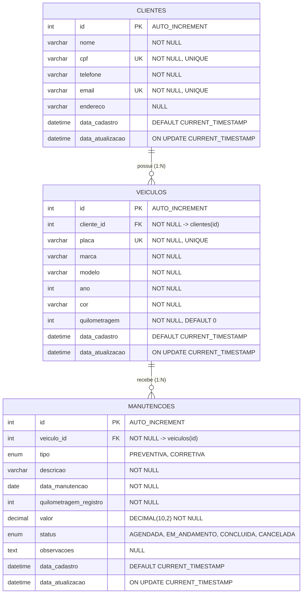

# AutoTrack — Sistema de Gestão de Manutenção Automotiva

---

### Integrantes do Grupo (Equipe de Desenvolvimento)
* **Matheus da Silva Gomes** — RA: **273137** (Autor Principal & Git)
* **Guilherme Coco da Costa** — RA: **272449**
* **Carlos Henrique Beltramo Rodrigues** — RA: **272766**

**Repositório Oficial:** [https://github.com/MatheusDev486/autotrack-manutencao-automotiva.git](https://github.com/MatheusDev486/autotrack-manutencao-automotiva.git)

---

## 1. Visão Geral do Projeto

### O Problema
Proprietários de veículos e gestores de frotas enfrentam constante dificuldade para controlar manutenções preventivas e corretivas: perda de histórico físico, ausência de rastreamento de quilometragem e desconhecimento do valor acumulado por automóvel. A falta de uma visão consolidada resulta em falhas mecânicas evitáveis e custos excessivos.

### A Solução AutoTrack
O **AutoTrack** centraliza o gerenciamento completo de proprietários (clientes), veículos e ordens de manutenção em uma arquitetura relacional robusta. O sistema garante integridade referencial estrita (`ON DELETE RESTRICT`), previne duplicações de chaves exclusivas (`UNIQUE`), oferece controle total via CRUD em interface moderna e disponibiliza consultas analíticas avançadas em tempo real com MySQL 8.

---

## 2. Tecnologias Utilizadas

| Camada | Tecnologia | Descrição |
| :--- | :--- | :--- |
| **SGBD** | **MySQL 8.x** / InnoDB | Persistência relacional estrita, chaves primárias e estrangeiras (`ON DELETE RESTRICT`), índices únicos, charset UTF-8 (`utf8mb4`) e conformidade total com `ONLY_FULL_GROUP_BY`. |
| **Back-end** | **Node.js 18+ & Express** | API REST estruturada em controllers e rotas, driver nativo `mysql2/promise` com SQL explícito via prepared statements (`?`) e tratamento de erros do SGBD (1451 e 1062). |
| **Front-end** | **HTML5 + Tailwind CSS + Vanilla JS** | Interface SPA fluida, responsiva, sem dependências externas complexas, com modais de cadastro e edição, validação de formulários e notificações contextuais. |
| **Versionamento** | **Git & GitHub** | Histórico de commits atômico, sem commits destrutivos, documentando cada avanço do projeto. |

---

## 3. Modelo de Dados Relacional (DER)

O diagrama abaixo representa as entidades, chaves primárias (PK), chaves estrangeiras (FK), campos únicos (UK) e relacionamentos (1:N) implementados no MySQL:



---

## 4. Abas da Aplicação

1. **Painel**: Visão executiva com cartões de indicadores (KPIs de clientes, veículos, manutenções, serviços ativos e volume financeiro), tabela de **Serviços por veículo** (total de OS e valor total por veículo) e tabela de **Veículos acima da média de valor** (veículos cujo valor acumulado ultrapassa a média geral da frota).
2. **Clientes**: Gestão completa (CRUD) de proprietários de veículos, com busca instantânea por nome ou CPF e formulário com validação.
3. **Veículos**: Gestão completa (CRUD) de automóveis associados a clientes, listando placa, marca, modelo, ano, cor, quilometragem e proprietário.
4. **Manutenções**: Controle de ordens de serviço (OS) preventivas e corretivas, registrando data, quilometragem, custo, status operacional e observações.
5. **Histórico**: Relatório consolidado unindo manutenções, veículos e proprietários em uma tabela detalhada.
6. **Consultas SQL**: Central de execução interativa das consultas SQL (Junção Relacional, Agregação e Subconsulta), exibindo o código SQL e a tabela de resultados em tempo real.

---

## 5. Mapa de Requisitos do Sistema

| Requisito | Descrição Técnica | Arquivos de Implementação |
| :--- | :--- | :--- |
| **PK, FK e Integridade** | Tabelas com `id` primário autoincrementável, chaves estrangeiras com `ON DELETE RESTRICT` e restrições `UNIQUE` em CPF, e-mail e placa | `database/schema.sql` |
| **Carga de Dados Realistas** | Inserções ordenadas respeitando dependências relacionais (5 clientes, 6 veículos e 11 manutenções) | `database/seed.sql` |
| **CRUD de Clientes** | Listagem, busca por ID, inserção, atualização e exclusão segura | `src/controllers/clienteController.js`<br>`src/routes/clienteRoutes.js` |
| **CRUD de Veículos** | Listagem com JOIN de clientes, inserção associada, atualização e exclusão | `src/controllers/veiculoController.js`<br>`src/routes/veiculoRoutes.js` |
| **CRUD de Manutenções** | Listagem com JOIN de veículos e clientes, inserção, atualização e exclusão | `src/controllers/manutencaoController.js`<br>`src/routes/manutencaoRoutes.js` |
| **Consulta 1 (INNER JOIN)** | Junção relacional tripla entre `manutencoes`, `veiculos` e `clientes` | `src/controllers/relatorioController.js` (`consultaJoin`)<br>`database/consultas_avaliacao.sql` |
| **Consulta 2 (GROUP BY)** | Agregação com `COUNT`, `SUM` e `AVG` agrupando por veículo, 100% aderente ao `ONLY_FULL_GROUP_BY` | `src/controllers/relatorioController.js` (`consultaAgregacao`)<br>`database/consultas_avaliacao.sql` |
| **Consulta 3 (Subquery)** | Subconsulta dinâmica com `HAVING` comparando o valor acumulado com a média geral | `src/controllers/relatorioController.js` (`consultaSubquery`)<br>`database/consultas_avaliacao.sql` |
| **Tratamento de Erro 1451** | Captura de tentativa de exclusão com registros dependentes e retorno HTTP 409 com mensagem explicativa | `src/config/database.js`<br>`src/controllers/clienteController.js`<br>`src/controllers/veiculoController.js` |
| **Tratamento de Erro 1062** | Captura de duplicidade em campos `UNIQUE` (CPF, E-mail, Placa) e retorno HTTP 409 | `src/config/database.js` |
| **Interface SPA** | Frontend responsivo, navegação por abas e integração REST via Fetch API | `public/index.html`<br>`public/js/app.js`<br>`public/js/api.js`<br>`public/css/styles.css` |

---

## 6. Como a Professora Pode Testar

### Pré-requisitos
* **Node.js 18+** instalado
* **MySQL 8** rodando em `localhost:3306`

---

### Passo 1: Configurar o Banco de Dados

#### Opção A — Pelo MySQL Workbench
1. Abra o **MySQL Workbench** e conecte-se ao seu MySQL local.
2. Abra e execute o arquivo `database/schema.sql` (cria o banco `autotrack_db` e as tabelas com constraints).
3. Abra e execute o arquivo `database/seed.sql` (insere os dados iniciais do sistema).

#### Opção B — Pelo Terminal / PowerShell
No diretório raiz do projeto:
```powershell
# Executa o schema (no Windows, caso necessário informe o caminho completo do mysql.exe)
mysql -u root -p < database/schema.sql

# Executa o seed
mysql -u root -p autotrack_db < database/seed.sql
```
*(Caminho padrão no Windows: `"C:\Program Files\MySQL\MySQL Server 8.0\bin\mysql.exe"`)*.

---

### Passo 2: Configurar o Arquivo `.env`

Crie o arquivo `.env` a partir do modelo `.env.example`:
```powershell
cp .env.example .env
```
Abra o `.env` e ajuste a senha do usuário `root` do seu MySQL local:
```env
PORT=3000
DB_HOST=localhost
DB_PORT=3306
DB_USER=root
DB_PASSWORD=sua_senha_aqui
DB_NAME=autotrack_db
```

---

### Passo 3: Instalar Dependências e Iniciar o Sistema

```powershell
# Instala as dependências do projeto
npm install

# Inicia a aplicação
npm start
```

Abra o navegador no endereço:
👉 **`http://localhost:3000`**

O indicador superior direito exibirá o status **Conectado** com o ponto verde.

---

## 7. Roteiro de Demonstração

Para avaliar todos os requisitos da disciplina, siga este roteiro prático diretamente no navegador:

### 1. Navegação pelas Abas
* Clique nas 6 abas no topo: **Painel**, **Clientes**, **Veículos**, **Manutenções**, **Histórico** e **Consultas SQL**.
* Observe a alternância sem recarregar a página e o carregamento automático dos dados.

### 2. Validação do Painel
* Veja os 5 cards com métricas calculadas em tempo real contra o MySQL.
* Analise a tabela **Serviços por veículo** com a quantidade de OS e o valor total acumulado.
* Analise a tabela **Veículos acima da média de valor**, conferindo o destaque da média geral calculada dinamicamente via subconsulta no subtítulo.

### 3. Provocando o Erro 1062 (Chave Única Duplicada)
* Vá para a aba **Clientes** e clique em **Novo Cliente**.
* Tente cadastrar um cliente preenchendo o CPF `111.222.333-44` (já cadastrado para Rodrigo).
* **Resultado esperado**: O sistema intercepta o erro 1062 do MySQL e exibe a mensagem amigável: *"Registro duplicado: CPF já cadastrado no sistema."*.
* Vá para a aba **Veículos** e tente cadastrar um veículo com a placa `BRA2E19`.
* **Resultado esperado**: Aviso de placa já cadastrada.

### 4. Provocando o Erro 1451 (Integridade Referencial / Foreign Key)
* Na aba **Clientes**, localize o cliente **Camila Beatriz de Souza** e clique no botão de lixeira (excluir). Confirme na janela modal.
* **Resultado esperado**: O sistema não apaga o registro e exibe o aviso claro:  
  *"Não é possível excluir este cliente: ele possui 1 veículo(s) cadastrado(s). Exclua os veículos primeiro."*.
* Na aba **Veículos**, localize o veículo **Civic Touring** (placa `RHE4F71`) e clique no botão de lixeira. Confirme na modal.
* **Resultado esperado**: O sistema não apaga o veículo e exibe:  
  *"Não é possível excluir este veículo: ele possui 2 manutenção(ões) registrada(s). Exclua as manutenções primeiro."*.

### 5. Testando Exclusão na Ordem Correta
* Crie um cliente temporário (ex.: *"Cliente Teste"*, CPF `999.888.777-00`).
* Cadastre um veículo para ele (ex.: placa `XYZ9999`).
* Cadastre uma ordem de manutenção para esse veículo.
* Tente excluir o cliente: o sistema bloqueia (erro 1451).
* Tente excluir o veículo: o sistema bloqueia (erro 1451).
* Exclua a manutenção recém-criada: operação concluída com sucesso.
* Exclua o veículo: operação concluída com sucesso.
* Exclua o cliente: operação concluída com sucesso.

### 6. Execução das Consultas na Aba Consultas SQL
* Acesse a aba **Consultas SQL**.
* Clique em **Consulta 1 (INNER JOIN)**: veja o código SQL formatado e clique em **Executar Consulta** para visualizar o histórico com as três tabelas integradas.
* Clique em **Consulta 2 (GROUP BY)**: veja o código SQL com `COUNT`, `SUM` e `AVG` e execute para conferir a agregação por veículo.
* Clique em **Consulta 3 (Subquery)**: veja a subconsulta dinâmica com `HAVING` e execute para verificar os veículos com valor superior à média geral.
